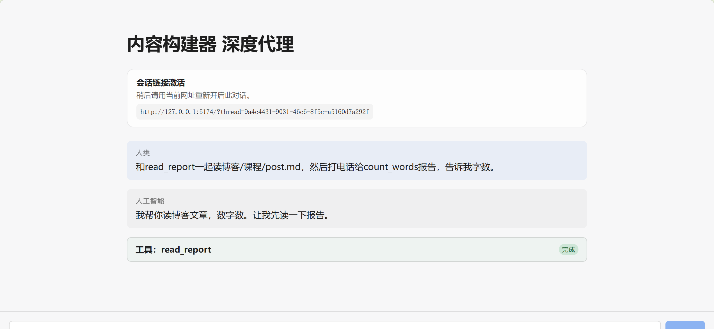
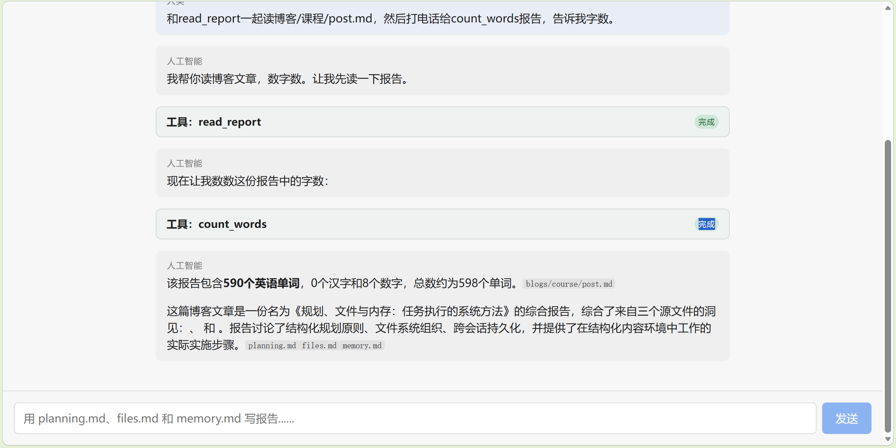

# 2026-10-14 Task01 · 我的第一个工具 Agent

> Task1 目标：跑通第一个 Deep Agent，让它调用一个自己的工具，说清「请求 → 执行 → 返回」发生了什么，并把模型 / 工具 / Middleware / Backend 一一对应到项目代码里。

## 1. 跑通主应用完整任务链

在网页（http://127.0.0.1:5174）执行 README 测试指令，Agent 自动完成 6 步任务：

```
read_source ×3 → write_todos → 起草 → save_report → read_report
```

- 三个源文件：planning.md、files.md、memory.md
- 报告落盘：`blogs/course/post.md`（英文报告，标题 "Planning, Files, and Memory: A Systematic Approach to Task Execution"，4547 字符）
- 前端工具卡片全部显示"完成"；报告可在本地文件系统直接读回。

## 2. 添加自定义工具 count_words

新增 `@tool count_words(text)`（`src/content_builder_deepagent/lesson_tools.py`），分类计数：

| 类别 | 正则 |
|---|---|
| 汉字 | `[\u4e00-\u9fff]` |
| 英文单词 | `[A-Za-z]+` |
| 数字 | `\d+` |

注册：`agent.py` 中 `tools = [read_source, save_report, read_report, save_preference, count_words]`。

验证：
- `uv run --frozen pytest tests -q`：14 passed
- 边界测试 4 例全对：空输入 0/0/0；纯空白 0/0/0；5000 字符长文本 1000 词；混合文本（100 汉字+50 词+10 数字）=160

## 3. 完整调用链验证（关键证据）

网页指令："read_report 读博客/course/post.md + count_words 统计字数"

- 工具卡片序列：read_report（完成）→ count_words（完成）→ 最终回答
- Agent 回答：**590 个英文单词、0 个汉字、8 个数字，总计 ≈ 598**
- 本地对照：直接调用 `count_words` 统计同一文件 → **590 / 8 / ≈598，与模型回答完全一致** ✅

结论：工具被真实执行，模型正确读取 ToolMessage 返回值并如实转述（非编造）。

运行证据截图：





## 4. 请求 → 执行 → 返回

1. **请求**：模型在响应中发出 `tool_calls`，包含工具名、参数与调用 id：
   ```
   {name: "count_words", args: {"text": "..."}, id: "call_xxx"}
   ```
2. **执行**：框架实际运行对应的 Python 函数，得到结果字符串。
3. **返回**：结果装入 `ToolMessage`（携带相同 `tool_call_id`）返回给模型；模型继续决策，最终生成面向用户的回答。

关键点：模型"提出调用"不等于"执行成功"，必须核对 ToolMessage 内容——本任务用本地对照证明了这一点。

## 5. 组件 ↔ 代码映射（Basic 档）

| 组件 | 代码位置 | 说明 |
|---|---|---|
| 模型 | `agent.py` `init_chat_model(DeepSeek-V3.2)`；`.env` SiliconFlow | OpenAI 兼容接口经 LangChain 适配 |
| 工具 | `lesson_tools.py` 的 `@tool` 函数；`agent.py` tools 列表 | 装饰器把 Python 函数变为模型可调用的接口 |
| Middleware | `TodoListMiddleware`（待办规划）、`MemoryMiddleware`（注入 AGENTS.md + 偏好）；内部 Skills / PatchToolCalls | 包在模型外围的处理层 |
| Backend | `FilesystemBackend(virtual_mode=True)` + SQLite checkpointer（本机适配） | 文件读写与会话状态持久化 |

## 6. 遇到的问题与修正

| 问题 | 原因 | 处理 |
|---|---|---|
| 前端报"无法连接 LangGraph 服务器（取回失败）" | 重启窗口期瞬时失败 | 刷新页面即恢复 |
| 嵌入式 SeekDB 不可用 | pylibseekdb 仅 Linux | .env 切换 SQLite 后端 |
| npm --prefix 报 ENOENT | npm 版本对 --prefix 的坑 | 进入目录后直接 npm install |

## 引用来源

- 课程仓库：https://github.com/datawhalechina/deepagents-in-action
- 课程站点：https://datawhalechina.github.io/deepagents-in-action/
- Notebook 实验说明：https://github.com/datawhalechina/deepagents-in-action/blob/main/notebooks/README.md
